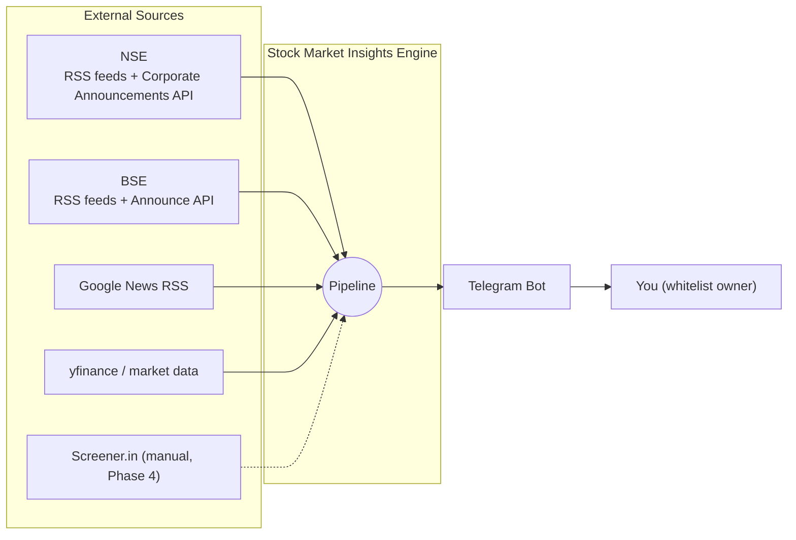
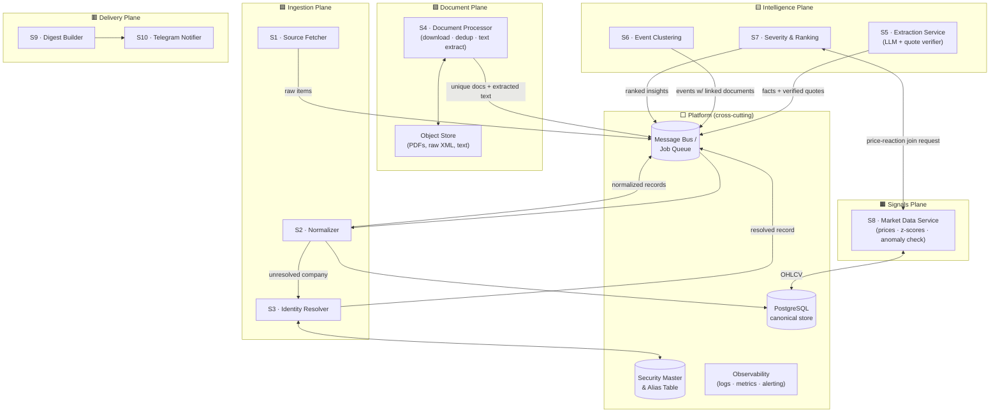
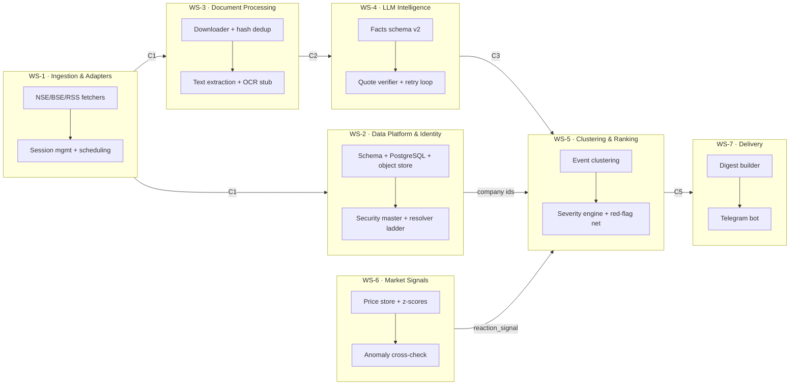
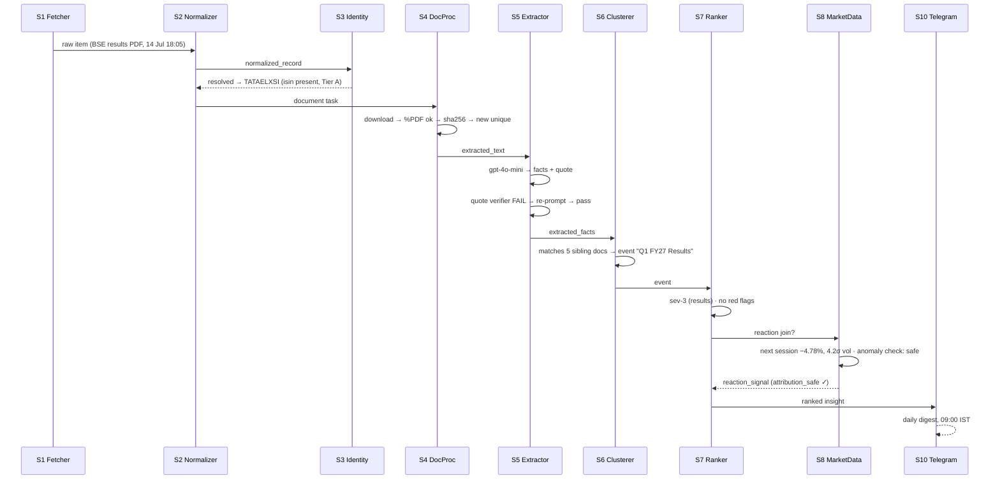

# High-Level Design — Stock Market Insights Engine

**Status:** Draft v1 · **Date:** 22 Aug 2026
**Companion docs:** [`product_note.html`](../product_note.html) (product spec), [`pilot_learnings.md`](../pilot_learnings.md) (evidence base), [`nse-bse-rss.md`](../nse-bse-rss.md) (source research)

---

## 1. Design Principles

1. **Every service boundary is pilot-proven.** The Tata Elxsi pilot validated each stage independently; service seams follow those stages exactly.
2. **Contracts over coordination.** Services communicate through documented JSON schemas (§5). Any two workstreams that agree on a contract can be built in parallel.
3. **Persist everything, lose nothing.** Raw feed items, raw XML, PDFs, and all intermediate artifacts are immutable and replayable (product note §6).
4. **LLM output is never trusted at face value.** Code-level verification gates exist wherever an LLM contributes content (quote verification §8, anomaly cross-check §10).
5. **Async, queue-mediated flow.** Each stage is a consumer of the previous stage's output topic — slow/stages can be retried independently.

---

## 2. Context Diagram

---

## 3. Services Overview

> **Reading the flow:** raw announcement → normalized record → resolved to whitelist entity → unique document with text → structured facts → clustered event → scored insight (+ price reaction) → digest.

---

## 4. Service Capability Cards

### S1 · Source Fetcher
| | |
|---|---|
| **Owns** | All exchange/API/RSS interaction. Polling schedules. Session management. |
| **Capabilities** | NSE adapter (Akamai cookie warm-up → API call), BSE adapter (direct API, unwrap `Table`), RSS pollers (both exchanges, Google News), yfinance price puller, per-source rate limiting, magic-byte validation on every download (`%PDF`, not HTTP 200) |
| **Emits** | `raw_feed_item` (immutable, source-faithful) |
| **Pilot constraint** | NSE and BSE have *structurally different* auth models — adapters must support per-source session state |

### S2 · Normalizer
| | |
|---|---|
| **Owns** | The canonical normalized record schema. Encoding fixes (UTF-8 BOM). |
| **Capabilities** | Map heterogeneous fields → one schema; timestamp normalization; dedupe trivially by `(exchange, document_url)` |
| **Emits** | `normalized_record` |

### S3 · Identity Resolver
| | |
|---|---|
| **Owns** | Security master, alias table, resolution ladder (Tiers A–F, product note §7). |
| **Capabilities** | Match filings ↔ whitelist entities via symbol/scripcode/ISIN/name+alias; confidence scoring; scripcode→ISIN backfill for BSE; collision detection (Bajaj/Kotak-class names) |
| **Emits** | `resolved_record` (or `unresolved` → review queue) |
| **Open risk** | Name-only matching untested against real collisions — needs stress test (pilot §7 gap) |

### S4 · Document Processor
| | |
|---|---|
| **Owns** | PDF lifecycle: download → verify → hash-dedup → text extraction. Object store layout. |
| **Capabilities** | SHA-256 hash tier dedup (validated: 58→28 docs, zero paraphrase dupes needed); pdfplumber extraction; OCR fallback stub (Phase 4); pdfminer log-noise filtering |
| **Emits** | `document` (hash, url, page count) + `extracted_text` reference |

### S5 · Extraction Service (LLM)
| | |
|---|---|
| **Owns** | Facts-schema extraction, verbatim quote guarantee, cost control. |
| **Capabilities** | gpt-4o-mini bulk extraction (~₹0.03/doc); **code-level quote verifier** (whitespace + hyphenation-normalized substring match) as a hard gate; retry-once-on-failure → suppress quote + downgrade confidence; self-reported `extraction_confidence` is ignored (proven non-predictive) |
| **Emits** | `extracted_facts` (facts[], summary, verified_quote, document_kind) |

### S6 · Event Clustering
| | |
|---|---|
| **Owns** | Collapsing many documents about one business event into one `event`. |
| **Capabilities** | Group by (company, tight date window, semantic similarity of summaries/facts); link N→M documents to events; handles the 6-docs-one-results-event case from the pilot |
| **Emits** | `event` (with linked document IDs) |
| **Status** | **Top blocking item** — only manually proven so far |

### S7 · Severity & Ranking
| | |
|---|---|
| **Owns** | Deterministic severity ladder, red-flag detection, digest ordering. |
| **Capabilities** | Keyword/document_kind rules; **red-flag regex safety net runs over facts text directly** (auditor resignation, adverse opinion, SEBI order, insolvency…) overriding category routing; governance split into `red_flag` vs `routine`; per-stock flood cap applied *after* clustering |
| **Emits** | `ranked_insight` (severity 1–5, cluster-aware) |

### S8 · Market Data Service
| | |
|---|---|
| **Owns** | Price history, statistical baselines, price-reaction attribution. |
| **Capabilities** | OHLCV storage; per-stock trailing baseline (return/volume z-scores); reaction join attached to *events*, not documents; **unexplained-anomaly cross-check** — if a comparable/larger move exists elsewhere in the window with no event, causal framing is suppressed or hedged |
| **Emits** | `reaction_signal` (reaction_pct, return_z, volume_z, attribution_safe flag) |

### S9 · Digest Builder + S10 · Telegram Notifier
| | |
|---|---|
| **Owns** | Daily ranked digest composition; delivery rules (caps, quiet hours); Telegram formatting. |
| **Consumes** | Ranked insights + reaction signals |
| **Emits** | Digest message (target format in product note §9) |

### Platform (cross-cutting)
- **Message bus / job queue** — retry semantics per stage; rolling-window sources mean *nothing may be silently dropped*.
- **PostgreSQL** — canonical normalized store; object URLs point to blob storage.
- **Security Master** — whitelist entities, symbols/scripcodes/ISINs, aliases.
- **Observability** — per-stage counters (items in/out, dedup ratio, quote-verify failure rate, unresolved-identity count). Quote-verify failure rate >2% = page.

---

## 5. Inter-Service Contracts (the parallelization enablers)

Five schemas are the entire integration surface. Freeze these first; everything else proceeds independently.

| # | Contract | Producer → Consumer | Status |
|---|---|---|---|
| C1 | `normalized_record` — per `nse-bse-rss.md` (exchange, company_name, nse_symbol, bse_scripcode, isin, subject, description, document_url, published_at, …) | S2 → S3/S4 | ✅ Built in pilot (`normalize.py`) |
| C2 | `document` + `extracted_text` (sha256, page_count, text_ref) | S4 → S5 | ✅ Built in pilot |
| C3 | `extracted_facts` (facts[], summary, verified_quote, document_kind) — needs widening: `growth_pct`, governance red-flag/routine split | S5 → S6/S7 | ⚠️ Pilot version exists; widen per pilot §17 |
| C4 | `event` (event_id, company_id, window, linked_document_ids, primary_kind) | S6 → S7/S8 | ❌ To define (blocking) |
| C5 | `insight` (severity, headline, facts, reaction_signal?, attribution_safe) | S7/S8 → S9 | ❌ To define |

---

## 6. Workstreams — Parallel Build Map

### What can start immediately (zero dependencies between them)

| Workstream | Scope | Depends on | Key open items from pilot |
|---|---|---|---|
| **WS-1** Ingestion | Fetchers for NSE/BSE/RSS/news/prices | Nothing | Cookie-refresh scheduler; AttachLive magic-byte handling |
| **WS-2** Platform & Identity | DB schemas, object store, security master, resolver | Nothing | Scripcode→ISIN join; name-collision stress test |
| **WS-3** Doc Processing | Download, dedup, extraction | Contract C1 only | OCR decision deferred (measure more companies first) |
| **WS-4** LLM Intelligence | Schema v2, extraction, quote gate | Contract C2 only | Retry-on-failure loop (unbuilt); widen growth_pct |
| **WS-6** Market Signals | Price store, z-scores, anomaly check | Nothing | Implement anomaly cross-check as reusable function |

### Dependency-gated (start after upstream lands)

| Workstream | Scope | Gate |
|---|---|---|
| **WS-5** Clustering & Ranking | Event clustering, severity engine | Needs C3 (facts) — but **contract design can start day 1** since it's the top blocker |
| **WS-7** Delivery | Digest builder, Telegram | Needs C5 — format mockups can proceed in parallel |

### Suggested sequencing

- **Week 1:** Freeze contracts C1–C5 · WS-1/2/3/4/6 all start in parallel
- **Week 2–3:** WS-5 builds against fixture data (pilot's 28 docs + hand-built clusters); WS-4 delivers verified extraction; WS-6 delivers anomaly check
- **Week 4:** Integration — full path end-to-end on Tata Elxsi replay · WS-7 ships digest v1

---

## 7. End-to-End Sequence (one filing's life)

---

## 8. Open Questions for HLD Review

1. Message bus choice for v1 — Redis Streams / RabbitMQ / plain Postgres-backed queue? (Volume is tiny; simplest thing that guarantees no-loss wins.)
2. One deployable monolith-with-module-boundaries vs. true separate processes? Recommendation: **modular monolith with contract-enforced module boundaries** — same parallelism, none of the ops cost, split later along the same seams.
3. Who owns contract evolution? Proposal: schema files live in `/contracts`, changes require both producer and consumer workstream sign-off.
