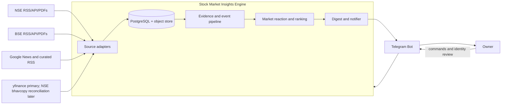
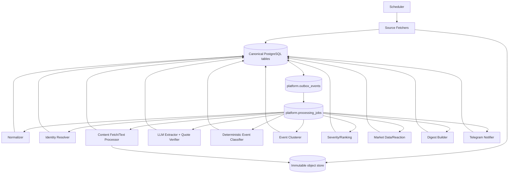
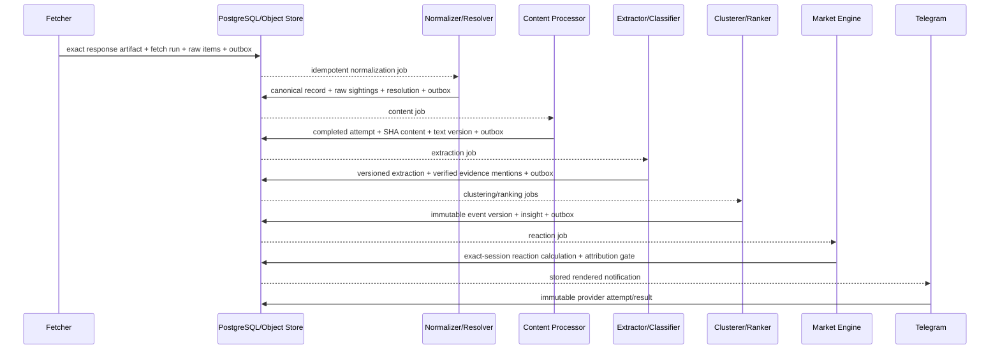

# High-Level Design — Stock Market Insights Engine

**Status:** v1.2 · **Architecture:** modular monolith with durable PostgreSQL work queue
**Companions:** [`database-schema.md`](database-schema.md) · [`db/schema.sql`](../db/schema.sql) · [`product_note.html`](../product_note.html) · [`pilot_learnings.md`](../pilot_learnings.md)

> **Implementation-status note (2026-08-23):** this is the approved target architecture,
> not a declaration that every capability below exists. Current code implements the object
> store, processing-job worker, per-company NSE/BSE API paths, M2/M3, and yfinance bars.
> Outbox dispatch, RSS/news/Screener DB capture, canonical content attempts/links, M4–M7,
> the M8 reaction engine, M9–M10, service supervision, backups, least-privilege roles, and
> phase gates remain incomplete.
> Current adapters also have documented invariant gaps. Use
> [`PROJECT_STATUS.md`](../PROJECT_STATUS.md) and the
> [comprehensive review](reviews/2026-08-23-comprehensive-review.md) for verified state.

---

## 1. Product boundary

The system watches a database-backed whitelist of Indian listed companies, captures official filings and selected news, extracts evidence, clusters related documents into business events, ranks explainable insights, joins daily market reactions and delivers a short Telegram briefing.

It is a personal research tool. It does not place trades and does not present statistical association as proven causation.

### Scale target

- initial whitelist: 10–25 companies;
- medium-term: 100 companies after measured coverage holds;
- eventual aspiration: approximately 500;
- daily rather than intraday market data;
- one owner and one Telegram recipient in v1.

The architecture optimizes for correctness, auditability and restart safety—not distributed-system throughput.

---

## 2. Design principles

1. **Fetched bytes precede parsing.** Exact HTTP/XML/HTML/PDF responses are persisted before an adapter can lose information.
2. **Measured coverage, not cursor optimism.** Partition checkpoints, overlap polling and reconciliation support a coverage metric; no cursor proves that a rolling source was complete.
3. **At-least-once work, idempotent results.** PostgreSQL jobs/outbox may redeliver; every stage has a stable idempotency key.
4. **Content and business events are different.** SHA-256 deduplicates bytes; clustering groups distinct documents about one development.
5. **Evidence is append-only and versioned.** Reprocessing creates text, extraction, event and reaction versions rather than rewriting history.
6. **The LLM extracts; code decides.** Model output supplies facts, summaries and evidence candidates. Versioned code performs event classification, quote verification, severity and ranking.
7. **Company, security and listing are different identities.** Company events can affect one or more instruments; prices belong to exchange listings.
8. **Causal language is gated.** Event timing, market session, benchmark and unexplained anomalies are retained. Even a “safe” result is phrased as association.
9. **One deployable first.** Module boundaries and DB contracts enable parallel work without premature microservices.
10. **No dual-write gap.** Canonical rows and outbox events commit atomically.

---

## 3. System context



---

## 4. Runtime architecture

The v1 runtime is a modular Python application with independently supervised worker processes. PostgreSQL is both the canonical database and durable queue. A filesystem/object store holds immutable response bytes and content.



### Job claim pattern

Workers claim ready jobs with `SELECT ... FOR UPDATE SKIP LOCKED`, set a lease and commit. On completion they write the canonical result plus an outbox event in one transaction, then mark the job succeeded. On failure they clear the lease, increment attempts and schedule backoff. Exceeding `max_attempts` moves a job to `dead` and raises an operational alert.

The outbox dispatcher itself is restartable. Re-publishing is harmless because downstream jobs/results are idempotent.

---

## 5. Module capability cards

> **Module detail specs:** the five source-capture modules (NSE, BSE, Google News,
> Screener and Yahoo/yfinance) have requirement specs in
> [`docs/modules/`](modules/README.md), including corrected source mechanics observed in
> the Aug-2026 pilots. Where this section and those specs disagree about source access
> mechanics, the module specs govern. Their status sections distinguish requirements from
> current code.

### M1 · Source adapters

**Owns:** source sessions, conditional GET, rate limits, partition scheduling and exact response persistence.

**Key behavior:**

- NSE RSS and API adapters keep independent partitions per feed/symbol;
- BSE RSS and API adapters preserve scrip codes and the API's `Table` envelope;
- Google News keeps one staggered partition per company/query and resolves redirect tokens before article fetch;
- every response body is written to immutable storage and registered by SHA-256 before parsing;
- PDF/HTML success is validated by media type and magic/content checks, not HTTP 200 alone;
- rolling windows are polled with overlap.

**Produces:** C1 fetched source item.

### M2 · Normalizer

**Owns:** adapter-independent source-record shape and canonical source-record idempotency.

**Key behavior:**

- creates `exchange_announcement`, `news_article` or generic source records;
- preserves source metadata without using exchange category as event classification;
- permits text-only items and missing/unparseable publication timestamps;
- links every duplicate sighting to one canonical record through `record_raw_items`;
- uses `(dedup_scope, dedup_key)`, not document URL, as announcement identity.

**Produces:** unresolved C2 canonical source record.

### M3 · Identity resolver

**Owns:** company/instrument/listing master, aliases, whitelist and fail-closed resolution.

**Resolution ladder:**

1. BSE scrip code/direct listing;
2. cross-exchange byte/record anchor;
3. exact document identifier such as symbol, ISIN or scrip code;
4. normalized unique company name;
5. curated alias;
6. manual resolution.

Fuzzy similarity may suggest review candidates but never publishes an assignment. Alias ambiguity resolves to review. Immutable decisions, the explicit current-assignment pointer and the normalized-record company cache must agree in one transaction. A correction appends a superseding decision and atomically repoints the assignment/cache.

**Produces:** resolved or review-state C2 record.

### M4 · Content processor

**Owns:** URL resolution, attempts, content-addressed bytes and text versions.

**Key behavior:**

- pending/retry state remains in the durable job;
- each completed network attempt is immutable and audit-visible;
- valid bytes become a content object regardless of PDF/HTML/text format;
- byte-identical objects deduplicate by SHA-256;
- records and content are M:N;
- text extraction is media-specific;
- image-only/unsupported content is explicitly recorded;
- a new extractor/config appends a text version.

**Produces:** C3 content and text.

### M5 · Evidence extractor

**Owns:** structured model execution and code-level quote verification.

**Key behavior:**

- reads one exact text version;
- stores provider/model/revision, prompt, output schema and verifier versions;
- records truncation, usage and cost;
- emits a document kind, facts, summary and evidence candidate;
- verifies whitespace/hyphenation-normalized source containment;
- retries once when policy allows, then suppresses unverified evidence;
- never trusts self-reported model confidence;
- failed/truncated outputs remain visible to QA and cannot silently ship.

**Produces:** extraction portion of C4.

### M6 · Event classifier and clusterer

**Owns:** business-event semantics and immutable cluster snapshots.

**Key behavior:**

- deterministic versioned rules turn extraction facts into zero or more event mentions;
- document kind and event kind are independent;
- a combined filing can produce several event mentions;
- clustering groups by resolved company, time, event-compatible facts and semantic similarity;
- one event may have several supporting contents; one content may support several events;
- every membership or classification correction creates a new event version;
- clustering never mutates a snapshot already used by an insight.

**Produces:** event portion of C5.

### M7 · Severity and insight engine

**Owns:** red-flag safety net, deterministic severity, insight wording and ranking inputs.

**Key behavior:**

- rulepack scans structured facts and evidence text, not only event/document categories;
- severe governance patterns override category defaults;
- rulepack and input fingerprint are stored;
- freshness is evaluated at digest-build time, not baked permanently into an insight;
- per-stock flood caps apply after event clustering;
- an insight is blocked if required evidence is unverified unless explicitly rendered without a quote and downgraded by policy.

**Produces:** insight portion of C5.

### M8 · Market data and reaction engine

**Owns:** listing-level daily series, provider corrections and event-study calculations.

**Key behavior:**

- selects the configured primary listing for reaction analysis;
- fixes provider, interval and adjustment method at price-series level;
- appends revised bar observations;
- maps the event cutoff to the correct market session, including after-close filings and holidays;
- calculates returns using only information available before the reaction session—no future/look-ahead baseline;
- optionally market/sector-adjusts the move;
- compares with nearby unexplained anomalies;
- records exact security and optional benchmark bars, exact baseline-bar membership, method and attribution rationale.

**Produces:** C6 reaction signal.

### M9 · Digest builder

**Owns:** coverage window, ranking, caps and exact composition.

**Key behavior:**

- reads immutable insights and eligible reaction signals;
- computes `severity × category weight × freshness` under the selected rulepack;
- records the exact score and selection reason per digest item;
- stores a versioned digest composition that may be superseded, not overwritten;
- renders within Telegram limits and emits a notification transactionally.

**Produces:** digest portion of C7.

### M10 · Telegram notifier

**Owns:** application-level notification idempotency and provider-attempt audit.

**Key behavior:**

- sends the exact stored rendered message;
- does not re-render on retry;
- records every attempt, Telegram message ID, response or error;
- detects/reduces duplicates through the notification key and provider history, while acknowledging Telegram cannot eliminate the crash-after-send/before-commit window without a provider idempotency API;
- supports digest, severity-5 and health/system notification kinds;
- bot commands query canonical rows and create review/whitelist commands through jobs.

**Produces:** delivery-attempt portion of C7.

---

## 6. Contracts

Queue payloads contain contract version, canonical entity ID and correlation information. They do not copy full documents or facts.

### C0 · Durable work event

```json
{
  "contract": "work_event.v1",
  "event_key": "normalized_record.created:4812",
  "event_type": "normalized_record.created",
  "aggregate_type": "normalized_record",
  "aggregate_id": "4812",
  "correlation_id": "fetch-run:912"
}
```

Canonical storage: `platform.outbox_events`, `platform.processing_jobs`.

### C1 · Fetched source item

```json
{
  "contract": "fetched_source_item.v1",
  "item_id": 123,
  "partition_id": 8,
  "fetch_run_id": 912,
  "artifact_id": 502,
  "idempotency_key": "native:NEWSID-..."
}
```

Canonical storage: `ingestion.fetch_runs`, `raw_artifacts`, `raw_feed_items`.

### C2 · Canonical source record

```json
{
  "contract": "canonical_source_record.v1",
  "record_id": 4812,
  "record_type": "exchange_announcement",
  "company_id": 42,
  "resolution_id": 733,
  "published_at": "2026-08-22T12:10:00Z"
}
```

`company_id` may be null only on unresolved/review flow. Canonical storage: `normalized_records`, `record_raw_items`, `identity_resolutions`, `identity_assignments`.

### C3 · Content and text

```json
{
  "contract": "content_text.v1",
  "record_id": 4812,
  "content_id": 991,
  "text_version_id": 1440,
  "media_type": "application/pdf",
  "text_status": "ok"
}
```

Canonical storage: `content_fetch_attempts`, `content_objects`, `record_contents`, `text_versions`.

### C4 · Extracted evidence

```json
{
  "contract": "extracted_evidence.v1",
  "extraction_id": 602,
  "text_version_id": 1440,
  "document_kind": "investor_presentation",
  "mention_ids": [810],
  "quote_verified": true
}
```

Canonical storage: `extractions`, `extracted_event_mentions`.

### C5 · Event snapshot and insight

```json
{
  "contract": "ranked_insight.v1",
  "event_id": 77,
  "event_version_id": 79,
  "event_kind": "financial_results",
  "insight_id": 201,
  "severity": 3,
  "rulepack_version": "severity-2026-08"
}
```

Canonical storage: `events`, `event_versions` and memberships, `insights`.

### C6 · Reaction signal

```json
{
  "contract": "reaction_signal.v1",
  "signal_id": 51,
  "event_version_id": 79,
  "series_id": 14,
  "reaction_trade_date": "2026-07-15",
  "attribution_status": "safe",
  "method_version": "event-study-v1"
}
```

Canonical storage: `price_series`, `price_bars`, `reaction_signals`, `reaction_baseline_bars`.

### C7 · Delivery

```json
{
  "contract": "notification.v1",
  "notification_id": 301,
  "notification_kind": "digest",
  "rendered_sha256": "...",
  "channel": "telegram"
}
```

Canonical storage: `digests`, `digest_items`, `notifications`, `delivery_attempts`.

---

## 7. End-to-end sequence



Example results-day behavior:

1. Six distinct filings may become six content objects.
2. Their document kinds differ: results statement, presentation, press release, board outcome.
3. Mentions classify to one business event kind: `financial_results`.
4. The clusterer creates one event version linking all evidence.
5. Severity produces one insight.
6. The market engine maps an after-close filing to the next trading session and records the exact baseline.
7. The digest contains one ranked item, not six document-level duplicates.

---

## 8. Timing and completeness

### Polling

- primary exchange feeds: every 5 minutes;
- category feeds: every 15 minutes;
- company news queries: hourly and staggered;
- prices: after market close;
- digest: 07:30 Asia/Kolkata;
- severity-5 alert target: within 30 minutes of source appearance.

Every partition keeps an overlap window. A cursor update occurs only after the artifact and parsed items commit. Failed parsing does not advance the successful checkpoint.

### Coverage measurement

The weekly coverage report reconciles sampled dates against exchange pages/APIs and reports captured/expected. Feed-depth telemetry detects suspicious truncation but is not treated as an authoritative denominator.

---

## 9. Reliability and transaction rules

### Producer transaction

A successful stage transaction contains:

1. canonical output row(s);
2. stage-run metrics;
3. one outbox event.

Only then is the input job marked succeeded. If the transaction rolls back, neither output nor event exists and the job can retry.

### Consumer idempotency

Each consumer derives a key from immutable inputs and behavior version, for example:

```text
text:{content_sha}:{extractor}:{extractor_version}:{config_hash}
llm:{text_sha}:{model_revision}:{prompt_version}:{schema_version}
cluster:{company}:{sorted_mention_ids}:{cluster_version}
insight:{event_version}:{rulepack_version}:{insight_type}
reaction:{event_version}:{series}:{method_version}:{reaction_date}
digest:{audience}:{coverage_window}:{rulepack}:{template}
```

Unique constraints reject duplicate results from redelivery.

### Recovery

- expired `running` job leases are returned to queued state by a sweeper;
- failed jobs use exponential backoff with jitter;
- dead jobs and source silence trigger a system notification;
- object writes use temporary names and atomic rename/upload completion before DB registration;
- backups include PostgreSQL and immutable object storage, with periodic restore tests.

---

## 10. Security and integrity

- API keys and Telegram tokens are environment secrets, never database seed data.
- Workers receive least-privilege schema grants in deployment; schema organization alone is not a security boundary.
- Evidence/snapshot tables have database update/delete guards.
- URLs and source text are untrusted input; HTML is sanitized before rendering.
- LLM text is data, never executable instructions.
- Telegram output escapes provider markup and enforces length limits.
- The system retains public filings/news for personal research; it does not redistribute a bulk archive.

---

## 11. Observability

Required metrics:

- fetch success, 304, latency and source silence by partition;
- feed item count, oldest/newest publication time and overlap depth;
- raw→normalized→resolved funnel by stage run;
- unresolved/review age and resolution tier;
- content fetch failures and invalid-content rate;
- text extraction/image-only rate;
- truncation, quote-verification and extraction-failure rates;
- cluster size and manual split/merge rate;
- severity distribution and red-flag alerts;
- market-data staleness and insufficient reaction baselines;
- queue age, retry/dead-job count and outbox lag;
- notification success, retry and duplicate-provider-ID rate;
- LLM spend by company/model/month.

Operational alerts include two-hour source silence on expected market days, dead jobs, quote-verification failures above the agreed threshold, stale daily prices and failed severity-5 delivery.

---

## 12. Deployment

### v1 target

- PostgreSQL (currently PostgreSQL 17 in loopback-bound Docker; containerization is an
  operational choice, not an architecture boundary);
- local filesystem/object directory with atomic writes and coordinated backups (backups are
  required but not yet implemented);
- Python scheduler, dispatcher and worker processes under systemd/NSSM/Task Scheduler
  (only the worker code currently exists; no tracked supervision units);
- no additional application containers required;
- no Redis/RabbitMQ required;
- one repository and one deployable release version.

### Future split seam

A module may become a separate process/service only when operational evidence justifies it. The outbox contracts and canonical-ID payloads already provide that seam. Database ownership/grants would be tightened before any physical split; cross-schema FKs are acceptable inside v1's monolith.

---

## 13. Delivery sequence

### Phase 0 — reliable capture

- PostgreSQL baseline and immutable object store;
- source partitions, fetch history, overlap checkpoints;
- durable jobs/outbox;
- NSE/BSE main feeds;
- security master/listings/whitelist;
- normalization and identity review;
- plain resolved-filing Telegram digest;
- reconciliation harness.

**Gate:** seven unattended days, restart tests, and measured reconciliation with no known whitelisted filing loss.

### Phase 1 — trusted evidence

- PDF/HTML text versions;
- versioned LLM extraction;
- normalized quote verifier and retry/suppression path;
- separate document/event taxonomies;
- multi-mention extraction;
- event cluster fixture set;
- deterministic severity and red-flag tests.

**Gate:** sampled claims have verified supporting evidence; cluster fixtures collapse known six-document result events correctly.

### Phase 2 — breadth and reactions

- remaining category feeds;
- Google News redirect/article processing;
- optional local embedding experiment for news paraphrase dedup;
- listing-level prices;
- no-look-ahead reaction method, benchmark and anomaly gate;
- bot history commands.

**Gate:** duplicate digest rate below target and reaction calculations pass hand-worked fixtures.

### Phase 3 — scale and hardening

- grow 25→100 only after coverage holds;
- budget breaker;
- role grants, backup restore drills and operational dashboards;
- results-season load/reconciliation test.

### Phase 4 — measured needs only

- OCR if image-only rate warrants it;
- fundamentals source and ratio rules if legally/compliantly available.

---

## 14. Resolved architecture decisions

| Question | Decision |
|---|---|
| Monolith or microservices? | Modular monolith with independent workers. |
| Queue technology? | PostgreSQL jobs + transactional outbox for v1. |
| Raw payload location? | Exact bytes in immutable object storage; metadata/hash in PostgreSQL. |
| Universal identity? | Company → instrument → listing; not ISIN alone. |
| Document/event taxonomy? | Separate vocabularies. |
| Event correction? | Append immutable event version; never rewrite delivered input. |
| Price adjustment? | Immutable series-level adjustment definition. |
| Causal price language? | Gated association with retained rationale, never proof. |
| Google News? | Phase 2, supported by generalized HTML/text content model. |
| Embeddings? | Deferred until real cross-source news dedup data exists. |

The price-provider question is resolved: yfinance is primary and NSE bhavcopy is a later
reconciliation source. The owner separately approved full-scope Screener capture on
2026-08-23, superseding the prior ToS-conditioned cadence; this policy change does not alter
the v1.2 boundaries or make fundamentals a Phase 0 gate. Open questions remain the
per-company API cadence, returned-frame versus transport provenance, fundamentals schema/
validation, host/supervision choice, and measured OCR/news rate limits.
