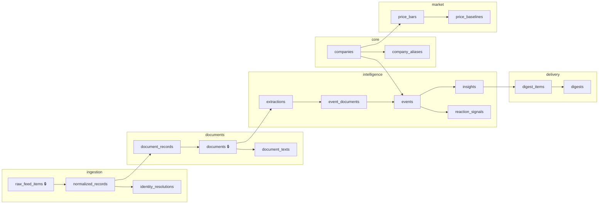

# Database Schema — HLD Companion

**Status:** Draft v1 · **Date:** 22 Aug 2026
**DDL:** [`db/schema.sql`](../db/schema.sql) — executable as-is (`psql -f db/schema.sql`)
**Upstream:** [`architecture-hld.md`](architecture-hld.md) (contracts C1–C5 map to tables below)

---

## 1. Schema-per-Plane Layout

One PostgreSQL database, six schemas. Each HLD service owns exactly one schema; cross-schema foreign keys are allowed only along the contract direction (downstream may reference upstream, never the reverse).



🔒 = append-only (no UPDATE/DELETE in normal operation)

| Plane | Owner service | Contract |
|---|---|---|
| `core` | S3 Identity Resolver | security master |
| `ingestion` | S1 Fetcher + S2 Normalizer + S3 | C1 `normalized_record` → table `normalized_records` |
| `documents` | S4 Document Processor | C2 → tables `documents`, `document_texts` |
| `intelligence` | S5/S6/S7/S8 | C3 → `extractions`; C4 → `events`; C5 → `insights` + `reaction_signals` |
| `market` | S8 Market Data | internal to S8 |
| `delivery` | S9/S10 | read-only over intelligence |

---

## 2. Entity-Relationship Diagram

```mermaid
erDiagram
    companies ||--o{ company_aliases : "has"
    companies ||--o{ identity_resolutions : "resolved-to"
    raw_feed_items ||--|| normalized_records : "normalizes"
    normalized_records ||--o{ identity_resolutions : "undergoes"
    normalized_records ||--o{ document_records : "points-at"
    documents ||--o{ document_records : "appears-in"
    documents ||--|| document_texts : "extracted-as"
    documents ||--o{ extractions : "yields"
    events ||--o{ event_documents : "clusters"
    documents ||--o{ event_documents : "belongs-to"
    events ||--|| reaction_signals : "reacted-with"
    events ||--o{ insights : "produces"
    insights ||--o{ digest_items : "ranked-in"
    digests ||--o{ digest_items : "contains"
    companies ||--o{ price_bars : "traded-as"
    companies ||--o{ price_baselines : "baselined"
    companies ||--o{ events : "about"

    companies { bigint company_id PK  text canonical_name  text nse_symbol UQ  text bse_scripcode UQ  text isin UQ }
    raw_feed_items { bigint item_id PK  text source  jsonb raw_payload  timestamptz fetched_at }
    normalized_records { bigint record_id PK  text exchange  text document_url  timestamptz published_at }
    documents { bigint doc_id PK  char64 sha256 UQ  bool is_valid_pdf  text storage_path }
    document_texts { bigint doc_id PK  int char_count  text extraction_method }
    extractions { bigint extraction_id PK  bigint doc_id FK  bool quote_verified  smallint verify_attempts  jsonb facts }
    events { bigint event_id PK  bigint company_id FK  timestamptz window_start  text cluster_method }
    insights { bigint insight_id PK  smallint severity  text severity_basis  text_array red_flag_hits }
    reaction_signals { bigint signal_id PK  numeric reaction_pct  numeric volume_zscore  bool attribution_safe }
```

---

## 3. Design Decisions & Pilot Evidence

### 3.1 M:N relationships are deliberate, everywhere

| Table | Why not 1:1 | Evidence |
|---|---|---|
| `document_records` | One byte-identical PDF arrived as **4 feed records** across both exchanges | pilot §5 |
| `event_documents` | One results event spanned **6 distinct documents** | pilot §12 |
| `digest_items` | Flood cap merges/drops; provenance must survive | pilot §12 |

### 3.2 LLM output: JSONB payload, real columns for what we query

- `extractions.facts` is JSONB — the schema *will* change (pilot §17 already demands `growth_pct`, governance split). JSONB absorbs evolution without migrations.
- But `document_kind`, `quote_verified`, `verify_attempts`, `quote_suppressed` are columns — ranking and QA queries filter on them.
- **No `extraction_confidence` column exists.** Pilot §10 proved self-reported confidence has zero correlation with verbatim compliance; the truth lives in code-computed `quote_verified`.

### 3.3 The quote-verification audit trail

`quote_verified` / `verify_attempts` / `quote_suppressed` implement the pipeline gate from pilot §10:
retry once on failure → suppress quote + downgrade rather than ship an unverified claim. An aggregate view over these columns doubles as the quality dashboard ("verify failure rate > 2% ⇒ investigate prompt").

### 3.4 Exchange category preserved but quarantined

`normalized_records.category_raw` stores NSE/BSE's own tags for forensics only — pilot §4 showed identical PDFs get unrelated categories across exchanges. Classification authority is `extractions.document_kind` + red-flag regexes.

### 3.5 Market data: cache the baseline

`price_baselines` stores per-stock trailing stats (63-day default) keyed by `as_of_date`, so the anomaly cross-check — *"did a comparable unexplained move happen elsewhere in the window?"* (pilot §16) — is one indexed scan, not a recompute per event.

### 3.6 Deduplication strategy in SQL terms

| Layer | Mechanism | Where |
|---|---|---|
| Feed refetch | `UNIQUE (source, md5(raw_payload))` | `raw_feed_items` |
| Same filing, same exchange | `UNIQUE (exchange, document_url, published_at)` | `normalized_records` |
| Cross-exchange duplicate | `UNIQUE (sha256)` | `documents` — validated at 58→28 |
| Paraphrase dupes (news) | simhash/embedding tier — *not yet in schema*, Phase 2 column on `documents` when built | open |

### 3.7 Immutability & replay

`raw_feed_items.raw_payload` keeps the untouched source item (JSONB), so any normalization or parsing bug can be fixed and replayed without re-fetching — feeds are rolling windows and old items vanish from them.

---

## 4. How Contracts Map to Tables

| Contract | Producer reads/writes | Consumer reads |
|---|---|---|
| C1 `normalized_record` | S2 writes `ingestion.normalized_records` | S3, S4 read it |
| C2 `document` + text | S4 writes `documents.documents`, `document_texts` | S5 reads |
| C3 `extracted_facts` | S5 writes `intelligence.extractions` | S6, S7 read |
| C4 `event` | S6 writes `intelligence.events`, `event_documents` | S7, S8 read |
| C5 `insight` | S7 writes `insights`; S8 writes `reaction_signals` | S9 reads |

Each workstream can develop against fixture rows in its upstream tables without any other service running.

---

## 5. Migration Policy

- v1 ships as a single `schema.sql`. From first integration onward, use numbered migrations (`db/migrations/001_*.sql`) — never edit applied DDL.
- `prompt_version` on `extractions` is the companion to schema migrations: facts-shape changes bump the prompt version so old JSONB rows remain interpretable.
