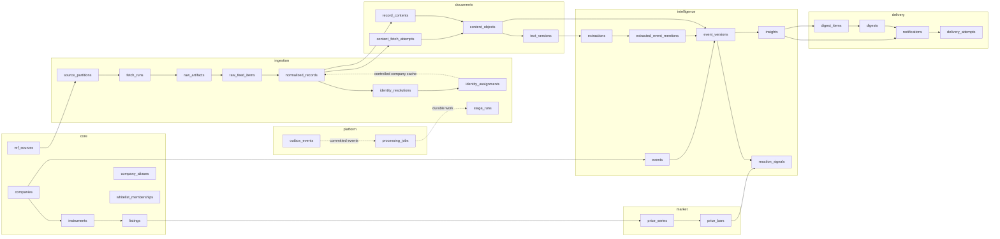

# Database Schema — v1.2 Companion

**Status:** v1.2 baseline · **DDL:** [`db/schema.sql`](../db/schema.sql)
**Upstream:** [`architecture-hld.md`](architecture-hld.md) · [`product_note.html`](../product_note.html)

Run a fresh database with:

```bash
psql -v ON_ERROR_STOP=1 -f db/schema.sql
```

> No database has been created yet. During brainstorming/solutioning, `db/schema.sql` is the single editable design baseline; no migration directory or migration ledger is needed.

---

## 1. What v1.2 fixes

| Prior problem | v1.2 decision |
|---|---|
| Google News could enter raw ingestion but not pass an NSE/BSE/PDF-only normalized model | Source records now support exchange announcements, news, feed text, HTML and PDFs. `exchange` and `content_url` are nullable where the source does not provide them. |
| `JSONB` was described as exact raw replay | Exact bytes are registered in `ingestion.raw_artifacts`; parsed `raw_payload` is only a query aid. |
| One cursor per source could not track 25 symbols or many RSS feeds | Checkpoints are one per `source_partition`, such as an RSS URL, NSE symbol, BSE scrip or news query. |
| Run counters had no row lineage | Raw artifacts/items reference fetch runs; all processing stages have idempotent `stage_runs` and row-level errors. |
| DB commit + queue publish could lose work | PostgreSQL-backed `processing_jobs` and a transactional `outbox_events` table provide durable hand-offs. |
| A “pending document” required a hash that does not exist before download | Pending work is a job; completed attempts are in `content_fetch_attempts`; immutable bytes are in `content_objects`. |
| Every content object was assumed to be a PDF | `content_objects.media_type` supports PDF, XML, HTML, text and later formats. PDF validity is content metadata, not the universal lifecycle. |
| Re-extraction replaced prior text | Every extraction creates an immutable `text_version`; LLM rows reference the exact version used. |
| Document kinds and business events shared one taxonomy | `ref_document_kinds` and `ref_event_kinds` are separate. |
| One extraction could express only one event | `extracted_event_mentions` supports multiple typed event candidates from one extraction. |
| Mutable clusters made historical insight inputs unclear | `events` is stable identity; immutable `event_versions` snapshot each membership/configuration revision. |
| Prices belonged to a company | Securities are `instruments`, venues are `listings`, and price series belong to listings. |
| A per-row adjustment Boolean allowed mixed price semantics | `price_series` fixes provider, interval and adjustment mode for every bar in the series. |
| Reaction rows omitted the session, baseline and method | Signals record exact bars, baseline window, method/input versions and attribution rationale. |
| One digest per date could not represent reruns or delivery attempts | Digest composition, rendered notification and provider delivery attempts are separate. |
| “Append-only” was a comment | Evidence and derived snapshots have database triggers rejecting update/delete. |

---

## 2. Domain layout

One PostgreSQL database contains seven organizational schemas. They are module seams, not independent service databases.



Cross-schema foreign keys follow data dependency. The schemas do not attempt to enforce network/service isolation inside a modular monolith.

---

## 3. Identity model

The model distinguishes three levels:

```text
company      HDFC Bank Limited
instrument   HDFC Bank equity share / ISIN
listing      NSE:HDFCBANK or BSE:500180
```

This avoids attaching venue-specific prices to a legal company and supports future share classes without redesign.

### Whitelist

`core.companies` is the security-master company set, not the whitelist itself. `core.whitelist_memberships` records addition/removal history, with a partial unique index allowing only one active membership per company.

### Aliases and ambiguity

Aliases carry an application-computed `normalized_value`. Uniqueness is per company, not global. If the same normalized alias appears for two companies, the resolver must return unresolved rather than silently choosing one.

### Resolution history

`identity_resolutions` is immutable attempt/decision history. Supersession is constrained to the same record. `identity_assignments` is the explicit mutable pointer to the currently accepted resolved decision, and `current_identity_resolutions` joins through that pointer. Checks ensure that:

- `resolved` requires a company;
- an unresolved attempt has no company;
- review rows are unresolved;
- a selected listing belongs to the selected company;
- confidence is between 0 and 1.

`normalized_records.company_id` is a resolver-controlled read cache. A trigger rejects every other normalized-record mutation, while deferred constraint triggers require the cache and current assignment to agree at transaction commit. A proven mis-attribution is corrected by appending a superseding decision, repointing `identity_assignments`, and updating the cache in one transaction; no historical decision is rewritten.

---

## 4. Lossless, partition-aware ingestion

### 4.1 Partition identity

A source is a provider family (`nse_rss`, `bse_api`, `google_news`). A partition is one independently polled stream, for example:

```text
(nse_rss, Online_announcements.xml)
(nse_api, symbol:TATAELXSI)
(bse_api, scrip:500408)
(google_news, company:42)
```

Cursors are keyed by `partition_id` and store adapter-specific `checkpoint JSONB`, a high-water timestamp and an overlap start. Adapters must poll overlapping windows and rely on idempotent writes; opaque external IDs are not assumed to be ordered.

### 4.2 Exact artifacts versus parsed items

`raw_artifacts` registers exact response bytes in immutable object storage using SHA-256, media type and size. `raw_feed_items` points to the artifact and stores parsed fields plus either `raw_payload` or an exact item fragment.

The artifact—not JSONB—is the replay source of truth.

### 4.3 Idempotency

Each adapter creates a documented stable `idempotency_key` within a source partition:

1. source-native ID where present;
2. otherwise a stable tuple such as canonical item URL + publication time + title;
3. never the volatile whole response body.

Every full response is still stored as an artifact before item-level deduplication, so adapter-key defects can be audited and reparsed.

Canonical `normalized_records` use `(dedup_scope, dedup_key)`. One canonical record may link to several `raw_feed_items` through `record_raw_items`, which handles the same announcement appearing in multiple category feeds without losing sightings.

### 4.4 Completeness claim

The database supports completeness **measurement**, not proof from a cursor alone. Coverage comes from:

- per-partition fetch history;
- item-count and oldest/newest timestamps;
- overlap polling;
- stage lineage and errors;
- external reconciliation samples.

The product may claim a measured coverage percentage, never “nothing was missed” merely because a cursor advanced.

---

## 5. Durable asynchronous processing

At this volume PostgreSQL is the queue.

### `platform.processing_jobs`

- unique `(job_kind, idempotency_key)`;
- priority and delayed availability;
- lease owner/time;
- bounded attempts;
- terminal `succeeded` or `dead` states.

Workers claim jobs with `FOR UPDATE SKIP LOCKED`. A failed job becomes claimable only after the worker clears its lease and sets a future `available_at`.

### `platform.outbox_events`

A producer inserts its canonical result and outbox event in the same transaction. The dispatcher publishes/enqueues pending events and marks them published. Consumers use their job or result idempotency key, so redelivery is safe.

### Stage observability

`ingestion.stage_runs` records code version and metrics for normalization, resolution, download, text extraction, LLM extraction, clustering, ranking and market calculation. `stage_errors` provides row-level diagnostics. Counts are no longer the only evidence connecting stages.

---

## 6. Generalized content lifecycle

```text
normalized record
  └─ processing job
      └─ completed content_fetch_attempt
          ├─ failed / invalid_content
          └─ ok → immutable content_object (SHA-256)
                    └─ immutable text_version(s)
```

A content object may be PDF, XML, HTML, plain text or another media type. `record_contents` is M:N because:

- several exchange records may point to one byte-identical PDF;
- one record may contain a primary filing and attachments;
- the same article/content may be observed through more than one source record.

Failed HTTP attempts, BSE HTTP-200 HTML error pages and redirects survive in attempt history. A failed fetch never requires inventing a document hash.

`text_versions` records extractor/version/config, status, exact text hash, page metrics and error. Reprocessing appends a version; it never replaces evidence. Downstream extraction references `text_version_id`, making the input exact.

---

## 7. Extraction, event semantics and provenance

### 7.1 Two taxonomies

`ref_document_kinds` describes artifacts such as:

- financial statement;
- auditor report;
- investor presentation;
- press release;
- board outcome;
- news article.

`ref_event_kinds` describes business developments such as:

- financial results;
- auditor change;
- dividend;
- regulatory action;
- order win;
- fundraising.

An investor presentation can therefore support a financial-results event without becoming the event type itself.

### 7.2 Model execution

An `extraction` is one immutable execution over one exact text version. It records:

- provider/model/revision;
- prompt, output-schema and verifier versions;
- truncation and token/cost metadata;
- document kind, facts and summary;
- candidate quote and verification state;
- stable idempotency key.

Self-reported model confidence is deliberately absent.

### 7.3 Multiple event mentions

One extraction may produce several `extracted_event_mentions`. These are typed by a versioned deterministic classifier over extracted facts. Each mention can carry its own facts, effective date and verified evidence location.

### 7.4 Immutable cluster snapshots

`events` supplies stable identity and company. Every cluster revision creates an immutable `event_version` with:

- event kind and direction;
- announcement/effective timing;
- cluster window/method/version/confidence;
- input fingerprint;
- optional superseded version;
- exact mention, content and affected-instrument membership.

An insight references an `event_version`, not mutable event membership. Re-clustering therefore cannot change the historical basis of an already-delivered insight.

---

## 8. Severity and insight reproducibility

An `insight` stores:

- immutable event snapshot;
- insight type;
- severity and basis;
- rulepack version;
- input fingerprint;
- exact red-flag rules that fired;
- headline/rationale;
- idempotency key.

`rulepack_version` alone is not described as magical reproducibility. Reproduction requires the referenced event snapshot, extraction/text versions, input fingerprint and rulepack code. All are now retained.

Freshness and digest-specific ranking are not stored on the insight because they change with time. `digest_items.ranking_score` records the exact score and selection reason used for that digest.

---

## 9. Market data and reaction attribution

### 9.1 Series-level semantics

A `price_series` belongs to a listing and fixes:

- provider and provider symbol;
- interval;
- adjustment mode;
- adjustment methodology version;
- currency.

This prevents adjusted and unadjusted bars from being mixed accidentally. Provider corrections append another `price_bar` observation; `current_price_bars` exposes the latest observation per series/date while old calculations can retain bar IDs.

Basic OHLC and nonnegative-volume constraints reject malformed bars.

### 9.2 Reaction calculation

A reaction signal references:

- immutable event version;
- exact price series;
- event cutoff and reaction trading date;
- exact before/reaction bars;
- exact optional benchmark series and before/reaction bars;
- exact baseline-bar membership plus baseline dates/session count and summary statistics;
- method and input versions;
- raw, z-score, benchmark and abnormal returns;
- unexplained-anomaly comparison;
- attribution status and human-readable reason.

Signals are append-only calculation history. A changed method or revised event version produces a new row rather than overwriting the old result.

`safe` means the configured evidence gates passed; it does not claim scientific causation. Digest copy must still use cautious language.

---

## 10. Delivery and retry safety

Delivery has four layers:

1. `digests` — coverage window, audience, template and rulepack version;
2. `digest_items` — exact ranked composition;
3. `notifications` — immutable rendered payload and hash for digest, red flag or system message;
4. `delivery_attempts` — one row per provider attempt and response.

There is no global unique `digest_date`; reruns, different audiences and superseded compositions are legal. `idempotency_key` identifies the intended composition/notification. Unique digest ranks prevent ambiguous ordering.

Provider retries resend the same rendered notification, not a newly rendered message. The provider message ID and response are retained for duplicate diagnosis.

---

## 11. Mutability policy

Database triggers reject update/delete on evidence and derived snapshots, including:

- raw artifacts/items and raw-record links;
- resolution decisions and stage errors (the current assignment pointer is mutable/audited);
- content objects, fetch attempts, record-content links and text versions;
- extractions and extracted mentions;
- event versions and their memberships;
- insights, price bars, reaction signals and insight links;
- digest composition and delivery attempts.

Mutable coordination/state tables include cursors, fetch/stage runs, job/outbox delivery state, digest status and notification status. Guards keep job/outbox identity and payload, digest identity and rendered notification content immutable while permitting those workflow fields to change.

Corrections are represented by a new version/superseding row, not an evidence rewrite. `normalized_records.company_id` is the one controlled cache: it may change only with a matching current identity assignment, enforced by deferred database triggers.

---

## 12. Contract-to-table map

| Contract | Producer | Canonical tables |
|---|---|---|
| C0 durable work/event | every module | `platform.processing_jobs`, `platform.outbox_events` |
| C1 fetched source item | source adapters | `fetch_runs`, `raw_artifacts`, `raw_feed_items` |
| C2 canonical source record | normalizer/resolver | `normalized_records`, `record_raw_items`, `identity_resolutions`, `identity_assignments` |
| C3 content + text | content processor | `content_fetch_attempts`, `content_objects`, `record_contents`, `text_versions` |
| C4 extracted evidence | extraction/classifier | `extractions`, `extracted_event_mentions` |
| C5 event snapshot + insight | clusterer/ranker | `events`, `event_versions`, memberships, `insights` |
| C6 market reaction | market service | `price_series`, `price_bars`, `reaction_signals`, `reaction_baseline_bars` |
| C7 delivery | digest/notifier | `digests`, `digest_items`, `notifications`, `delivery_attempts` |

Every producer transaction writes its canonical row(s) and one outbox event. Consumers receive IDs, then read the canonical contract from PostgreSQL; large text/bytes remain in object storage or their canonical table rather than being copied through queue payloads.

---

## 13. Deliberate non-features

The baseline still does **not** add:

- table partitioning at 20–25 stocks;
- cached price baselines;
- a separate Redis/RabbitMQ deployment;
- multi-tenant/RLS machinery;
- embedding columns before the Phase-2 news dedup experiment;
- OCR infrastructure before measured need;
- fundamentals-derived ratio claims;
- automated trading data or execution tables.

These are additive later. They do not justify weakening current lineage or integrity.

---

## 14. Schema evolution policy

### While brainstorming (current state)

- `db/schema.sql` is the only database design artifact.
- Revise it directly as requirements change.
- Do not create migration files or a migration ledger for databases that do not exist.

### When the first persistent/shared database is created

- Freeze the applied baseline and record its version.
- Introduce a migration tool/directory from that point onward.
- Apply future DDL and behavior-bearing reference-data changes through forward migrations.
- Test backup restoration before relying on a migration in production.

Behavioral lineage is required independently of DDL migrations: prompt, extraction-schema, classifier, cluster, verifier, rulepack, price-adjustment and reaction-method versions remain persisted in their output rows. Immutable historical outputs are superseded, never rewritten.
