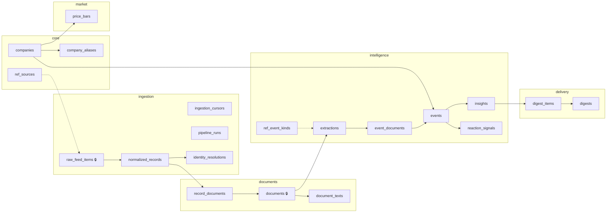

# Database Schema — HLD Companion

**Status:** v1.1 (post architect review) · **Date:** 22 Aug 2026
**DDL:** [`db/schema.sql`](../db/schema.sql) — executable as-is (`psql -f db/schema.sql`)
**Upstream:** [`architecture-hld.md`](architecture-hld.md)

> **v1.1 changelog (architect self-review):**
> 1. Record dedup key fixed: `(exchange, external_id)` — the old `(exchange, document_url, published_at)` unique would have silently dropped legitimate records sharing a PDF URL (pilot §5).
> 2. Refetch dedup moved to source-native IDs; content-hash uniques removed (volatile feed fields make byte-comparison fail both ways).
> 3. Growing vocabularies → reference tables (`ref_sources`, `ref_event_kinds`); CHECKs kept only for closed state machines.
> 4–5. Added `ingestion_cursors` + `pipeline_runs` for gap detection and funnel observability.
> 6. `price_bars.is_adjusted` added — adjusted/unadjusted mixing across a split corrupts z-scores.
> 7. `normalized_records.company_id` denormalized as the resolver's fast path.
> 8. `insights.rulepack_version` — severity reproducibility after regex tuning.
> 9. `published_at` made nullable — unparseable dates must not lose rows.
> 10. `price_baselines` dropped (YAGNI at 25 stocks).
> 11. Schema-per-plane repositioned honestly: organization + future-split seams, not enforced service boundaries.
> 12. `document_records` renamed `record_documents`.
> 13. Event taxonomy is now data (`ref_event_kinds`), not prose.

---

## 1. Layout: schemas as seams, not walls

One PostgreSQL database, six schemas. They organize the modular monolith and mark where a future split would cut. **Cross-schema foreign keys flow one way only — downstream references upstream, following contract direction.** No other isolation is enforced, on purpose.



🔒 = append-only (no UPDATE/DELETE in normal operation; single sanctioned exception: back-fill of `normalized_records.company_id` by the identity resolver)

| Plane | Owner service | Contract |
|---|---|---|
| `core` | S3 + shared vocabularies | security master, `ref_sources` |
| `ingestion` | S1/S2/S3 | C1 → `normalized_records`; plus cursors & run funnel |
| `documents` | S4 | C2 → `documents`, `document_texts` |
| `intelligence` | S5/S6/S7/S8 | C3 → `extractions`; C4 → `events`; C5 → `insights`, `reaction_signals` |
| `market` | S8 | internal to S8 |
| `delivery` | S9/S10 | read-only over intelligence |

---

## 2. Entity-Relationship Diagram

```mermaid
erDiagram
    companies ||--o{ company_aliases : "has"
    companies ||--o{ identity_resolutions : "resolved-to"
    raw_feed_items ||--|| normalized_records : "normalizes"
    normalized_records ||--o{ identity_resolutions : "undergoes"
    normalized_records ||--o{ record_documents : "points-at"
    documents ||--o{ record_documents : "appears-in"
    documents ||--|| document_texts : "extracted-as"
    documents ||--o{ extractions : "yields"
    events ||--o{ event_documents : "clusters"
    documents ||--o{ event_documents : "belongs-to"
    events ||--|| reaction_signals : "reacted-with"
    events ||--o{ insights : "produces"
    insights ||--o{ digest_items : "ranked-in"
    digests ||--o{ digest_items : "contains"
    companies ||--o{ price_bars : "traded-as"
    companies ||--o{ events : "about"

    companies { bigint company_id PK  text canonical_name  text nse_symbol UQ  text bse_scripcode UQ  text isin UQ }
    ref_sources { text source_code PK  int poll_interval_sec }
    raw_feed_items { bigint item_id PK  text source FK  text external_id  jsonb raw_payload }
    pipeline_runs { bigint run_id PK  text source FK  int items_fetched  int items_new  int docs_new }
    ingestion_cursors { text source PK  text last_external_id  timestamptz last_success_at }
    normalized_records { bigint record_id PK  text exchange  text external_id  bigint company_id FK  timestamptz published_at }
    documents { bigint doc_id PK  char64 sha256 UQ  bool is_valid_pdf  bool is_adjusted_note }
    document_texts { bigint doc_id PK  text extraction_method  bool extraction_ok }
    extractions { bigint extraction_id PK  bigint doc_id FK  text document_kind FK  bool quote_verified  smallint verify_attempts  jsonb facts  text prompt_version }
    ref_event_kinds { text kind_code PK  text plane  string description }
    events { bigint event_id PK  bigint company_id FK  text event_kind FK  text cluster_method }
    insights { bigint insight_id PK  smallint severity  text rulepack_version  text_array red_flag_hits }
    reaction_signals { bigint signal_id PK  numeric reaction_pct  numeric volume_zscore  bool attribution_safe }
    price_bars { bigint company_id PK  date trade_date PK  numeric close  bool is_adjusted }
    digests { bigint digest_id PK  date digest_date UQ  string status }
```

---

## 3. Design Decisions

### 3.1 Deduplication lives in three layers, each with a *reliable* key

| Layer | Key | Where | Why this key |
|---|---|---|---|
| Feed refetch | `(source, external_id)` — partial unique | `raw_feed_items` | Source-native ID survives payload re-serialization; content hashes break when feeds embed volatile fields |
| Same-exchange repeat | `(exchange, external_id)` — partial unique | `normalized_records` | The exchange's own announcement identity; distinct records sharing one PDF URL **survive** (pilot §5: same PDF tagged both `Record Date` and `Updates` by NSE alone) |
| Cross-exchange duplicate | `UNIQUE(sha256)` | `documents` | Byte-identity — validated at 58→28 in the pilot |

Paraphrase-level news dedup (simhash/embedding) remains future work — it becomes an additional column/index on `documents`, not a redesign.

### 3.2 Vocabulary policy: reference tables vs CHECK constraints

The rule applied throughout: **if the vocabulary grows, it's data; if it's a closed state machine, it's a CHECK.**

| Mechanism | Applied to | Rationale |
|---|---|---|
| Reference table (`ref_sources`) | data sources | New source = INSERT, never ALTER; also carries poll interval config |
| Reference table (`ref_event_kinds`) | document/event taxonomy | Single source of truth for the LLM prompt, severity router, and stored values; pilot §11's governance red_flag/routine split lives here as rows |
| CHECK kept | `severity` 1–5, resolution tiers A–F, download/digest/run status, `exchange` NSE/BSE | Genuinely closed sets; a CHECK documents intent better than an empty lookup table |

LLM output that doesn't match any known kind is normalized to `'other'` at write time and logged — the FK enforces hygiene without rejecting rows.

### 3.3 Completeness is tracked, not assumed

Rolling-window feeds mean old items vanish — so *"did we miss anything?"* must be answerable from the database:

- **`ingestion_cursors`** — per-source last-seen item/time and consecutive-failure counter; gaps between cursor position and wall clock reveal polling misses.
- **`pipeline_runs`** — per-run funnel (`items_fetched → items_new → records_created → docs_new`). When counts diverge between runs you know *when* it happened, not just that it did.

### 3.4 LLM output: JSONB payload, real columns for what we query

- `extractions.facts` is JSONB — the schema *will* change (pilot §17 demands `growth_pct`, etc.). JSONB absorbs evolution; `prompt_version` keeps old rows interpretable.
- `document_kind`, `quote_verified`, `verify_attempts`, `quote_suppressed` are columns because ranking and QA filter on them.
- **No `extraction_confidence` column exists.** Pilot §10 proved self-reported confidence carries zero signal. Quality = code-computed quote columns; a partial index (`idx_extractions_qa`) makes the QA scan ("what failed verification lately?") cheap.

### 3.5 Severity must be reproducible

`insights.rulepack_version` records *which version of the rules* assigned the score. Without it, tuning the red-flag regexes makes every historical severity unexplainable. `red_flag_hits TEXT[]` names the exact patterns that fired.

### 3.6 Prices carry their adjustment semantics

`price_bars.is_adjusted` states whether closes are split/bonus-adjusted. Z-scores computed across an adjustment boundary are meaningless — the column forces the writer to decide and lets the anomaly cross-check refuse to mix regimes.

### 3.7 Identity fast path

`normalized_records.company_id` (nullable) is set once by the resolver. Consumers get a one-index-join answer for resolved records; `identity_resolutions` retains full attempt history for audit and the review queue.

### 3.8 M:N relationships remain deliberate

| Table | Why not 1:1 | Evidence |
|---|---|---|
| `record_documents` | One PDF arrived as 4+ feed records, including 2 within one exchange | pilot §5 |
| `event_documents` | One results event spanned 6 distinct documents | pilot §12 |
| `digest_items` | Flood cap merges/drops; provenance must survive | pilot §12 |

### 3.9 What was deliberately left out

- **`price_baselines`** — trailing stats over ~25 stocks are computed on the fly in milliseconds; caching was premature. Revisit only if profiling disagrees.
- **Listings table** — companies with multiple listed securities (e.g., DVR share classes) model poorly on single `nse_symbol`/`isin` columns. Acceptable for a curated whitelist; documented limitation, split later if ever needed.
- **Multi-session reactions** — one reaction signal per event covers v1; widening to `(event_id, trade_date)` is additive if needed.

---

## 4. Contract-to-Table Map (parallel-work enablement)

| Contract | Producer writes | Consumer reads |
|---|---|---|
| C1 `normalized_record` | S2 → `ingestion.normalized_records` | S3, S4 |
| C2 `document` + text | S4 → `documents.documents`, `document_texts` | S5 |
| C3 `extracted_facts` | S5 → `intelligence.extractions` | S6, S7 |
| C4 `event` | S6 → `intelligence.events`, `event_documents` | S7, S8 |
| C5 `insight` | S7 → `insights`; S8 → `reaction_signals` | S9 |

Each workstream develops against fixture rows in its upstream tables with no other service running.

---

## 5. Migration Policy

v1.1 ships as a single `schema.sql`. From first integration onward: numbered migrations in `db/migrations/`, never edit applied DDL. `prompt_version` / `rulepack_version` are the behavioral companions to schema migrations — logic evolution is recorded in data, not git archaeology.
